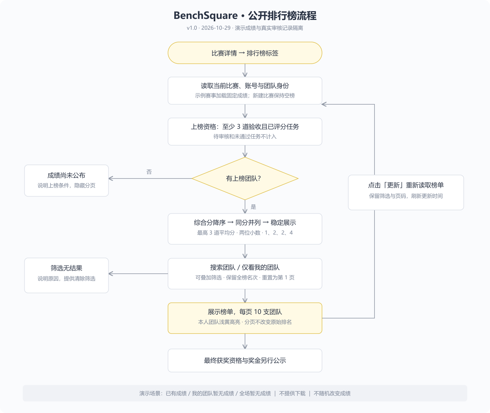
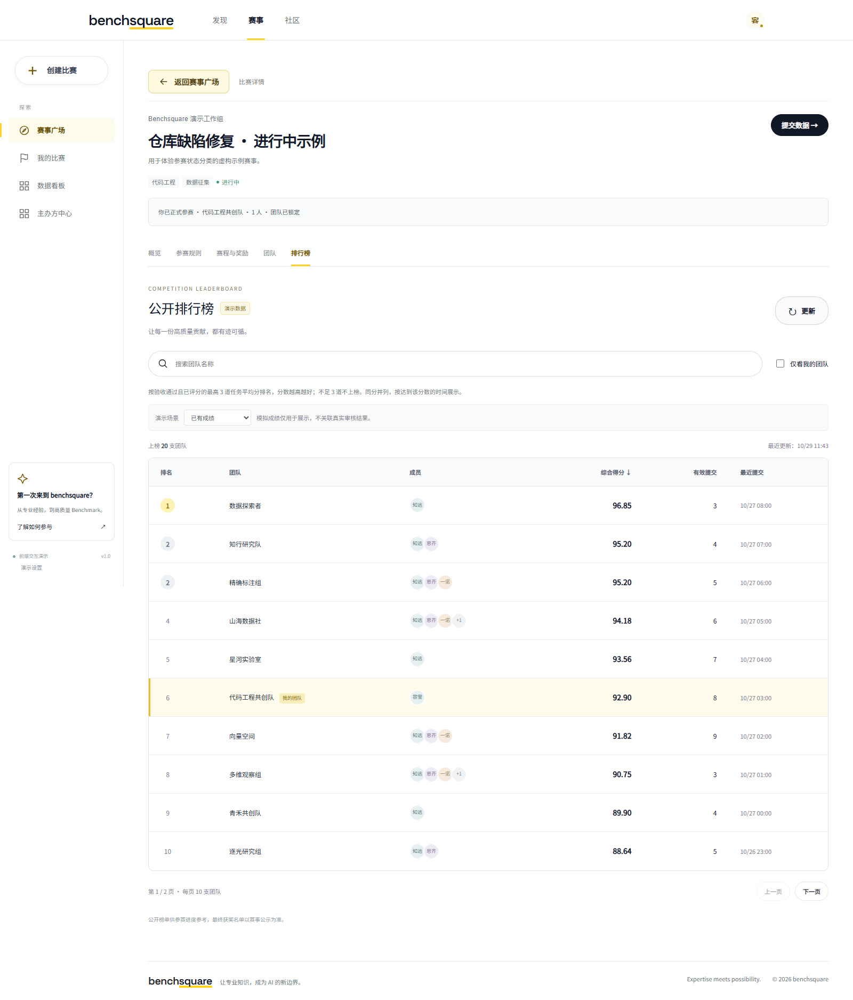
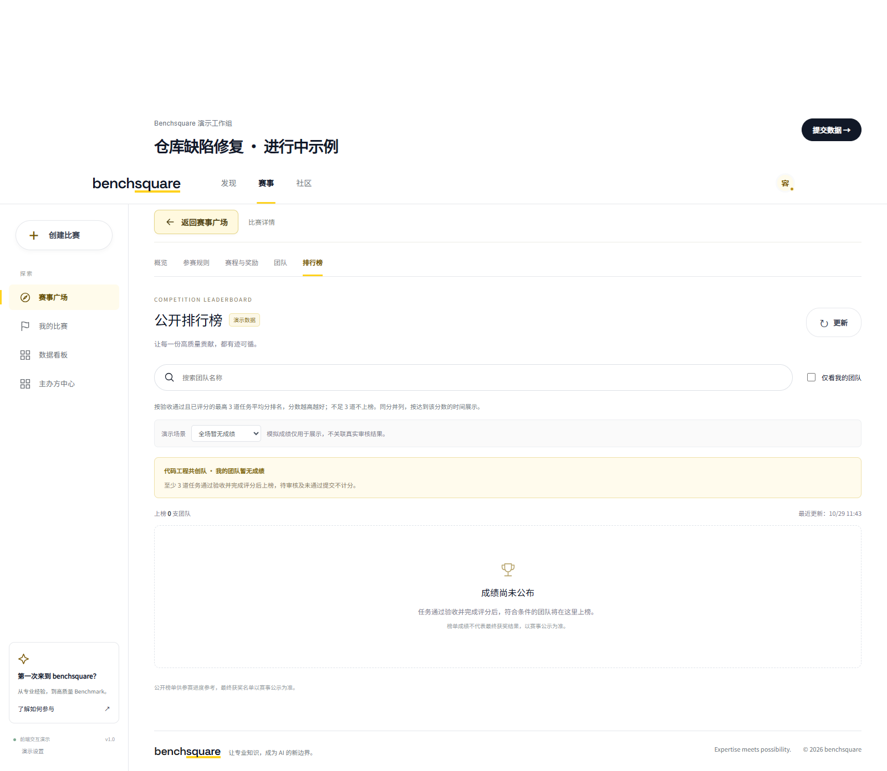
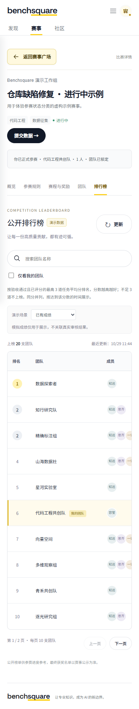

# 榜单公示 PRD

文档版本：v1.0 ｜ 状态：Demo 已实现 / 待评审 ｜ 更新日期：2026-10-29 ｜ 产品：BenchSquare 赛事模块  
目标读者：产品 / 设计 / 前端 / 后端 / 测试

## 1. 一句话概述

为参赛者提供 Kaggle 风格的公开团队排行榜，在比赛详情集中查看综合质量得分、有效提交和团队排名，支持搜索、仅看我的团队、分页与更新。本期为本地前端 Demo，明确标注演示成绩，不包含榜单下载、真实评分服务或自动发奖。

## 2. 背景与范围

原页面只有“成绩尚未公布”占位。本次提供通栏榜单，沿用白底、黄色强调色；排行榜标签隐藏奖金侧栏，其他标签保持原布局。

仅系统内置示例赛事加载 20 支固定虚构团队，普通用户新建比赛不自动填充成绩。演示数据与真实提交、审核记录隔离。场景切换不会改变团队或审核状态。

## 3. 字段与规则

| 字段 | 规则 |
| --- | --- |
| 排名 | 综合分降序，同分并列，采用 1、2、2、4 形式；筛选和分页保留全榜名次 |
| 团队 | 一队一行，本人团队浅黄色高亮并标识“我的团队” |
| 成员 | 姓名缩写头像，最多显示 3 位，其余显示人数，悬停显示姓名 |
| 综合得分 | 验收通过且已评分的最高 3 道任务平均分，两位小数；不足 3 道不上榜 |
| 有效提交 | 验收通过且已评分的任务数，不以提交次数决定排名 |
| 最近提交 | 最近一次有效提交时间，北京时间展示 |

同分团队按达到该分数的时间先后展示，时间仍相同则按团队标识稳定排序，不打破并列。演示直接提供固定综合分，不模拟真实评分计算。最终获奖、并列奖项和奖金分配另行公示。

## 4. 交互

- 搜索团队名称：实时包含匹配，忽略首尾空格和英文大小写；变化时回到第 1 页。
- 仅看我的团队：从当前账号和当前比赛团队关系读取，未组队时禁用；可叠加搜索。
- 分页：每页 10 支，边界按钮禁用，无结果隐藏分页。
- 更新：重新读取榜单并更新显示时间，保留搜索、筛选与有效页码；固定模拟成绩不随机变化。
- 每个账号、比赛分别维护会话内筛选状态。
- 窄屏表格仅在自身容器横向滚动，搜索与筛选纵向排列。
- 不提供下载和导出入口。

## 5. 状态

| 场景 | 页面表现 |
| --- | --- |
| 已有成绩 | 20 支团队，第 2、3 行并列第 2，已组队用户团队第 6 名 |
| 我的团队暂无成绩 | 保留其他团队榜单，说明至少 3 道任务验收评分后上榜；仅看本人时局部空态 |
| 全场暂无成绩 | “成绩尚未公布”，说明上榜条件，隐藏表格与分页 |
| 搜索无结果 | 明确文案，提供清除筛选 |
| 未组队 | 禁用“仅看我的团队”，提示报名并组队 |

## 6. 流程图

[可编辑 SVG 源文件](flowchart.svg)

## 7. 原型图

原型由实际运行的 Demo 截图，涵盖桌面成绩榜、空榜和窄屏布局。

## 8. 验收与验证

- 排名模型：资格过滤、并列顺序、原始输入不变、筛选保留名次、分页边界、我的团队关系。
- 浏览器：更新成绩稳定、搜索、我的团队筛选、三种场景、清空筛选、分页、切换标签恢复侧栏、窄屏无整页横向溢出、跨赛事状态隔离。
- 原有六组测试与构建检查通过。

运行：`npm test`、`npm run build`；浏览器测试 `node frontend/leaderboard-browser.test.cjs`（需要 Playwright 和本机 Edge，依赖可通过 `BENCHSQUARE_PLAYWRIGHT` 指定）。

## 9. 同步位置

- [飞书 PRD：榜单公示](https://xcnhc87xvcni.feishu.cn/wiki/RKSuw34n4iiDuJknB5IcnSfvn8f)
- [格式参考：个人数据看板 PRD](https://xcnhc87xvcni.feishu.cn/wiki/KuP4wFgtdifEhUkh9fNc6U4Lngg)
- 代码：`frontend/leaderboard.js`、`frontend/leaderboard-model.js`、`frontend/leaderboard.css`。
