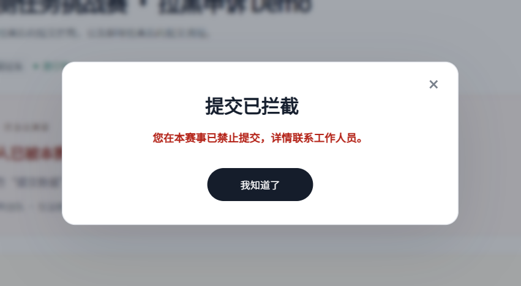

# 提交拉黑与拦截提示

更新日期：2026-11-23；变更人：容莹。

关联：[飞书 PRD](https://xcnhc87xvcni.feishu.cn/wiki/NL8swuPDLiRKstkMOOfcKN31npe) · [在线 Demo](https://rongyinger.github.io/benchsquare/frontend/#competition/blocked-team-demo)。演示地址保留旧标识以兼容已有链接，实际规则已改为个人拉黑。

只按「赛事＋个人」限制提交，不支持团队拉黑。该个人被拉黑后不能新提交或补正重提；同队队长、其他成员及其他赛事的资格不因此改变。保存草稿、历史数据与审核记录继续保留。解除拉黑后仍执行原报名、实名认证、赛程及任务归属校验，不延长截止时间。

主办方示例在每位成员旁提供「拉黑个人／解除个人拉黑」，必须指定个人；旧团队标记不再参与资格判断，不自动转换为全员个人拉黑。模拟新提交、补正重提时按选中的个人重新校验，写入前仍需读取最新状态。

被拉黑者点击「提交数据」直接显示「提交已拦截」。弹窗包含红色说明、右上角关闭按钮和「我知道了」。提示文案为「您在本赛事已禁止提交，详情联系工作人员。」关闭后回到原页面。

Demo 验证覆盖同队成员及赛事隔离、新提交和补正重提拦截、解除后的截止时间校验、草稿及历史记录保留，以及拦截弹窗的文字和关闭行为。
