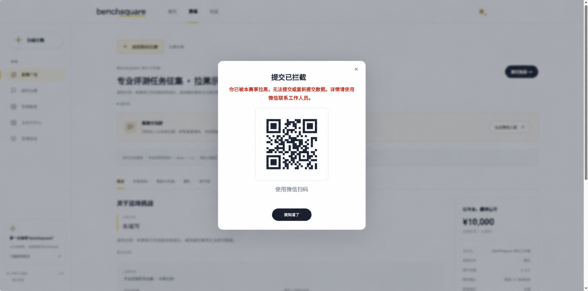

# 提交拉黑：个人限制与微信联系

更新日期：2026-11-23；变更人：容莹。

关联：[飞书 PRD](https://xcnhc87xvcni.feishu.cn/wiki/NL8swuPDLiRKstkMOOfcKN31npe) · [在线 Demo](https://rongyinger.github.io/benchsquare/frontend/#competition/blocked-team-demo)。演示地址保留旧标识以兼容已有链接，实际规则已改为个人拉黑。

只按「赛事＋个人」限制提交，不支持团队拉黑。该个人被拉黑后不能新提交或补正重提；同队队长、其他成员及其他赛事的资格不因此改变。保存草稿、历史数据与审核记录继续保留。解除拉黑后仍执行原报名、实名认证、赛程及任务归属校验，不延长截止时间。

主办方示例在每位成员旁提供「拉黑个人／解除个人拉黑」，必须指定个人；旧团队标记不再参与资格判断，不自动转换为全员个人拉黑。模拟新提交、补正重提时按选中的个人重新校验，写入前仍需读取最新状态。

被拉黑者点击「提交数据」直接显示「提交已拦截」，不打开选稿抽屉。红字为「你已被本赛事拉黑，无法提交或重新提交数据。详情请使用微信联系工作人员。」二维码下删除「演示二维码 · 非真实联系方式」标签，仅保留「使用微信扫码」。关闭或点击「我知道了」返回原页面。其他赛事交流群弹窗不属于本需求调整范围。

该图以原 PRD 图片编辑，仅用于样式说明；交互行为以 Demo 为准。本地二维码沿用现有示例资源，不代表已接入真实工作人员微信。生产环境需配置有效联系二维码；本次没有采集或替换真实联系方式。

验证覆盖：个人与同队成员隔离、不同赛事隔离、新提交和补正重提拦截、解除后仍检查截止时间、旧团队标记不影响队友、原任务及历史不被改写、直接接口模拟的未授权操作、弹窗无演示标签并显示微信扫码。自动检查只证明本地模拟行为，未接入真实服务端数据库或生产权限。
