ALE / Benchsquare · Task提交与Task审核 · v1.3 · 移除难度自测

负责人：容莹｜更新日期：2026-10-29｜适用对象：产品、设计、前后端研发、测试与赛事运营

# 一、文档说明

本文以2026-10-29当前在线Demo为交互基线，覆盖个人数据看板、通用草稿、比赛选稿、12项表单、本地保存、模拟提交与审核、修改工作副本和历史版本。正文、流程图与本版截图统一描述当前实际行为；生产能力及已知限制分别列出，不把本地模拟表述为真实入库或正式录用。

## 1.1 名词解释

| 名词 | 当前含义 |
| --- | --- |
| 个人数据看板 | 侧栏“数据看板”入口，集中整理当前演示身份的个人数据，支持按比赛或按状态查看。 |
| 通用草稿 | 未关联比赛的个人草稿，可先整理内容，在比赛提交入口中选择并关联赛事。 |
| 比赛草稿 | 已关联比赛的个人草稿；草稿保存不要求完成组队或处于提交期。 |
| 正式提交版本 | 本地模拟提交后形成的Task内容快照、编号和版本，保存比赛、团队与提交人关联。 |
| 修改工作副本 | 已提交任务另存的修改草稿；原提交内容、审核记录和历史版本继续保留。 |
| 看板状态 | 草稿、待审核、已审核、已录用四类展示分组，不等同于全部审核处理阶段。 |
| 本地保存 | 文字及任务记录保存在当前浏览器，实际附件通过浏览器文件存储保存；不代表服务器上传或数据库入库。 |
| 模拟审核 | 任务详情内手动改变阶段并记录意见；示例结果不代表平台正式授权、实际终检或官方录用。 |

## 1.2 需求范围

本期按PC网页端核对。当前Demo包含：全局个人数据看板、未关联与已关联草稿、比赛详情提交入口、草稿选择页、右侧编辑抽屉、四分区12项表单、分类附件本地保存及下载、公开／私有内容分区预览、模拟提交编号及版本、模拟审核意见、修改工作副本及历史快照。

当前没有真实身份认证、服务端权限、远程文件上传、正式任务审核后台、真实终检转交与结果回传、Task站内通知和官方有效数据统计。已有比赛发布／托管／上线管理后台，与Task审核不是同一业务。

不新增队长批准提交、多层级审批、自动分奖或自动打款。团队排名、贡献计分与队内材料共享不由本篇自行定义。

## 1.3 本次调整

2026-10-29：删除难度自测整个板块及四项字段；更新四分区进度、预览和历史兼容口径。

| 事项 | v1.2按当前Demo同步 |
| --- | --- |
| 新入口 | 增加全局个人数据看板，支持先准备个人草稿再关联比赛。 |
| 比赛内提交 | 我的比赛→查看团队与赛事→比赛详情→提交数据→从草稿中选择／新建数据任务→表单。 |
| 归属 | 草稿按本人管理，可未关联比赛；正式提交才检查比赛、团队、报名和赛程。 |
| 展示状态 | 使用草稿、待审核、已审核、已录用四类看板分组，同时保留审核阶段和历史意见。 |
| 附件 | 新入口支持浏览器持久保存、刷新恢复及下载；本地实际单文件上限1GB，正式目标规格50GB。 |
| 修改 | 当前所有状态均可进入修改工作副本；保存修改稿后看板归为草稿，原正式记录保留。 |
| 图示 | 重绘当前入口与状态流程；本次移除旧P08难度自测页，后续原型顺延；表单、验证标准、确认及详情截图按本次实现重新获取。旧后台设计图移出当前交互原型。 |
| 边界 | 现有规则缺口在4.10列明；生产能力与待落地要求单列，不能据截图认定实现完成。 |

# 二、需求背景

## 2.1 产品与数据现状

当前体验已从“进入比赛后填写任务”扩展为“先整理个人数据、再选择比赛提交”。个人数据看板集中展示本人记录，比赛详情提供选稿与新建入口，两处共用任务编辑器。已有12条可手动载入的合成示例，覆盖四种展示状态；示例比赛、附件及审核结论均用于演示。

本版在原字段基础上移除Model、Harness、Estimated score与Evidence四项难度自测内容，保留12项业务字段。表单不再采集自测信息，也不增加其他替代字段。

## 2.2 用户场景与痛点

| 场景 | 当前支持 |
| --- | --- |
| 尚未选定比赛 | 从数据看板新建通用草稿，先保存不完整内容。 |
| 已选比赛准备提交 | 在比赛详情打开选稿抽屉，选择本比赛或未关联草稿，也可新建。 |
| 跟踪个人贡献 | 按比赛／状态查看，搜索短名、描述、领域或比赛，筛选及排序。 |
| 根据反馈修改 | 打开原任务修改工作副本，保留此前提交与意见，正式重提形成新版本。 |
| 复核材料与历史 | 在详情中查看公开和私有内容分区、附件下载、审核进度及历次快照。 |

# 三、一句话目标

让每位参赛者先整理自己的专业任务，再关联比赛独立提交，并在同一套个人记录中查看反馈、修改副本与历史版本。

本版验收区分“当前交互复现”与“生产接入”。保存、上传、审核、录用均须明确本地演示边界，不将示例数量解释为真实业务数据。

# 四、功能详细说明

## 4.1 产品流程图

图1描述当前两种入口与共用编辑器，图2描述模拟审核阶段、四类看板分组及赛程边界。两图均依据当前Demo，不再将远程入库、站内通知或正式后台画成已完成环节。

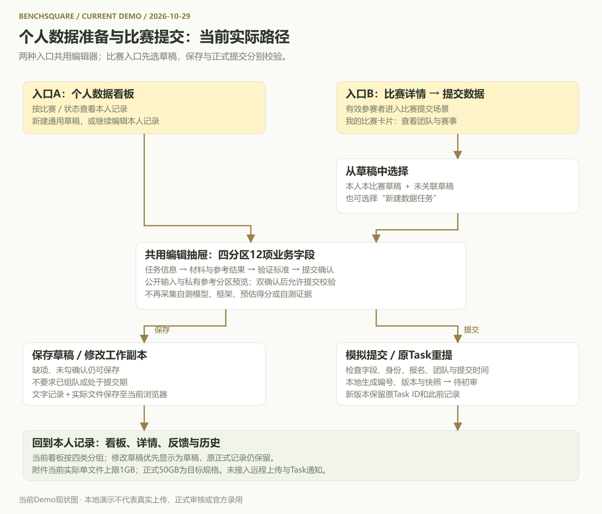

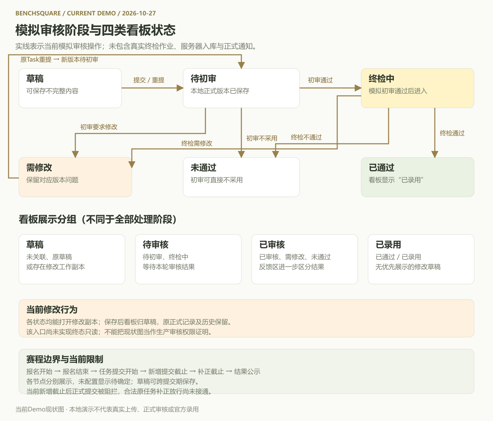

当前模拟审核操作中，待初审可初审通过进入终检中、要求修改或直接未通过；终检中可确认已通过、需修改或未通过。重提形成新版本并进入待初审。合成示例的历史可能是简化记录，不作为审核关卡完整性的证明。

## 4.2 交互原型图

受影响的表单、验证标准、确认及详情截图于2026-10-29从本次Demo实现重新获取，其余页面沿用原图；使用明确标注的合成示例及演示比赛。截图日期、记录数量与比赛时间只说明本次演示场景，不代表正式活动数据。本次删除旧P08并将后续编号顺延至P12；受影响表单与详情截图已更新，其余页面沿用既有演示图。

### P01 个人数据看板：按比赛

侧栏新增数据看板，顶部统计本人四类状态，支持比赛筛选、关键词搜索和排序。示例数据不自动代表真实审核。

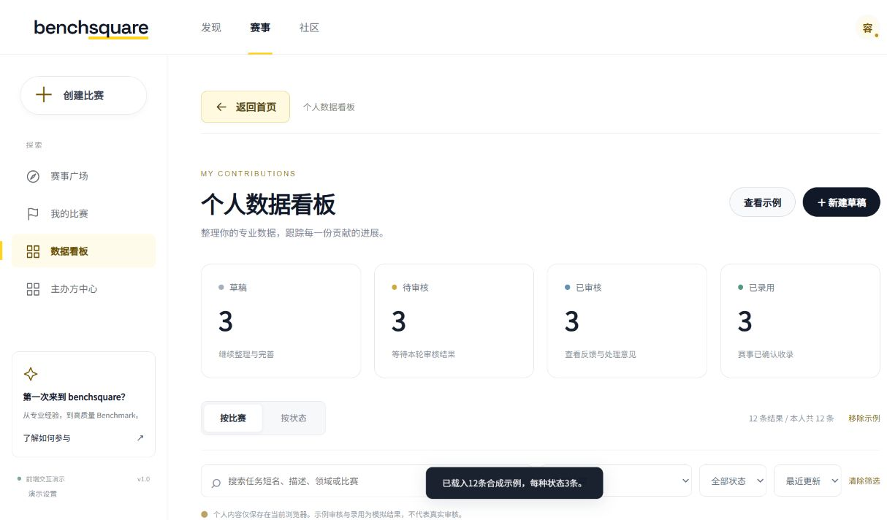

### P02 个人数据看板：按状态

四列分别为草稿、待审核、已审核、已录用。四类为展示分组，详细审核意见和内部阶段仍在任务记录中保留。

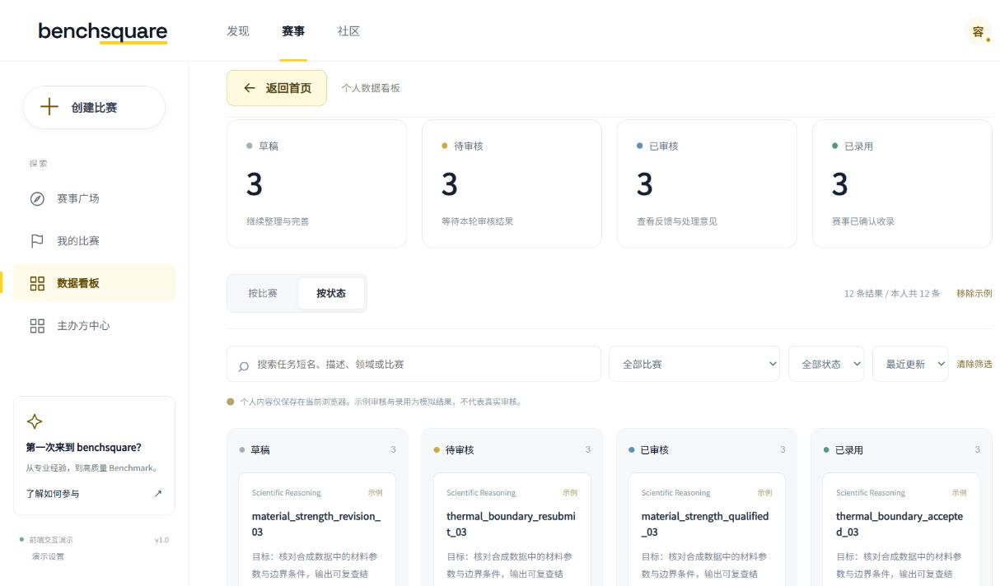

### P03 比赛详情提交入口

我的比赛中已参赛卡片提供查看团队与赛事；已组队比赛详情显示提交数据。点击后打开右侧选稿抽屉，不直接进入空表单。

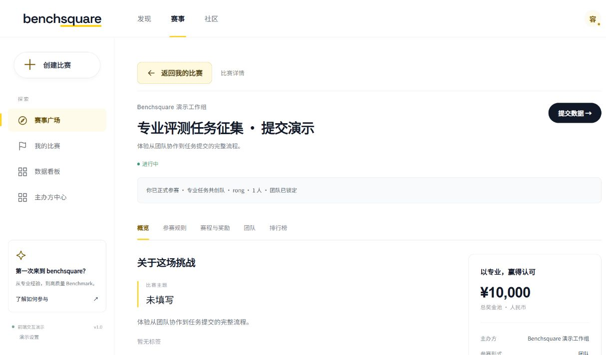

### P04 从草稿中选择

仅列出本人本比赛及未关联比赛的草稿；可新建数据任务。选择不会立即改变记录归属，保存或提交时才关联赛事。抽屉提供我的提交与草稿入口。

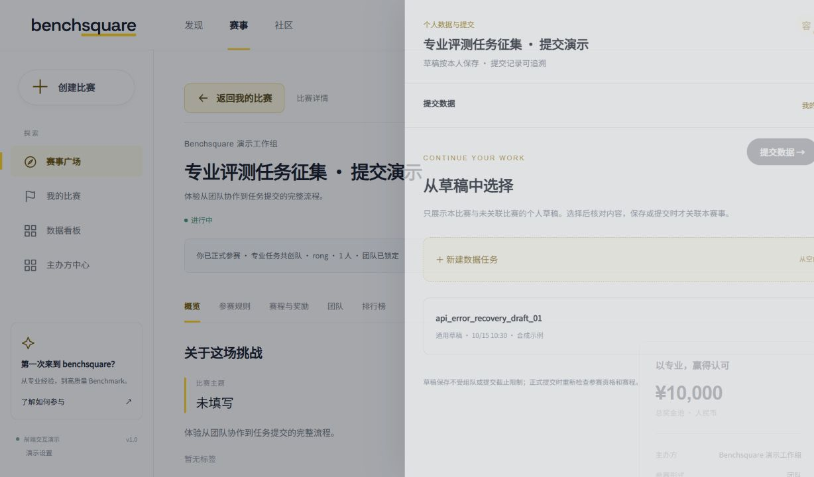

### P05 关联比赛与任务信息

共用表单增加关联比赛选择，可暂不关联；已正式提交且已关联的记录锁定比赛。抽屉标题显示来源比赛，当前顶部不单列团队名称。

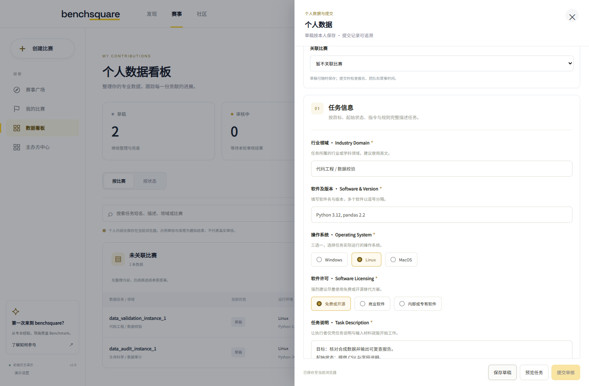

### P06 材料与参考结果

当前入口支持附件随保存存入浏览器，并在刷新后恢复和下载。实际本地单文件超过1GB被拒绝；上传区仍显示正式目标50GB，属于现有提示口径限制。

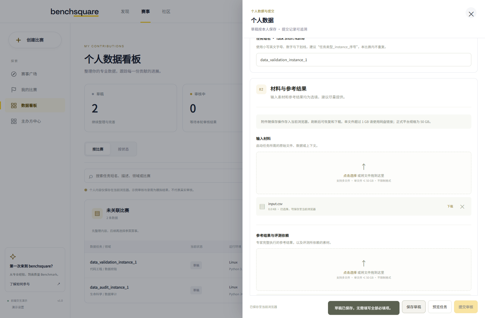

### P07 成功验证标准

填写客观检查方法、容差、必检项及否决项，支持安全Markdown编辑与预览；按私有材料分区展示。

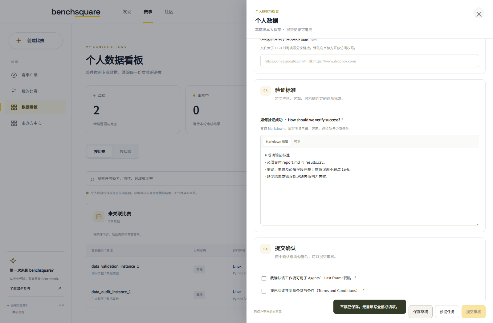

### P08 双确认与提交

新表单两项确认默认未勾选，缺任一项时提交审核置灰；保存草稿不要求完成确认。旧提交记录可恢复此前确认值。

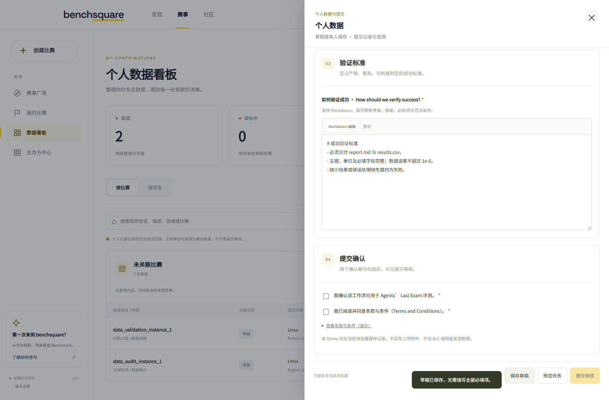

### P09 我的提交与草稿

抽屉内显示本人记录、状态、编号／提交次数和更新时间。当前共用列表取本人跨比赛记录，尚未按来源比赛过滤，不应读成仅当前比赛的任务清单。

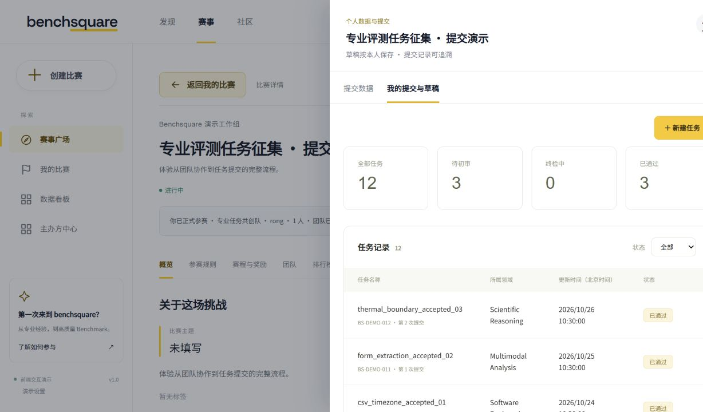

### P10 任务详情

详情展示任务信息、验证标准、私有参考与确认信息；仅显示输入材料和参考附件，自测字段与旧自测附件不再展示。当前已录用等状态仍有修改入口，具体限制见4.10。

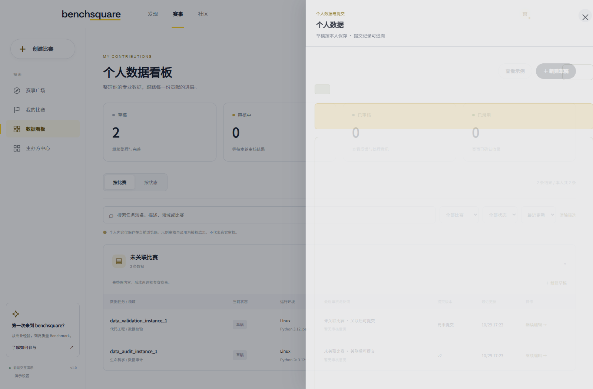

### P11 审核意见与历史版本

展示模拟审核意见、对应版本及历史快照。看板已录用记录的内部阶段可显示已通过；两种名称分别属于展示分组和审核阶段。

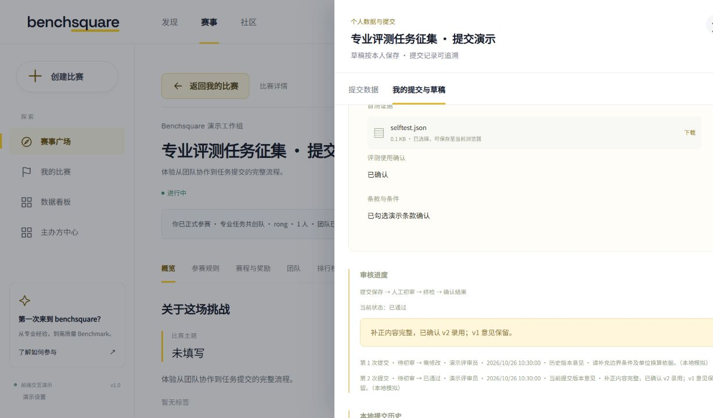

### P12 六节点赛程

报名开始、报名结束、任务提交开始、新增提交截止、补正截止、结果公示分别展示。演示比赛未配置的补正和公示时间显示待确定。

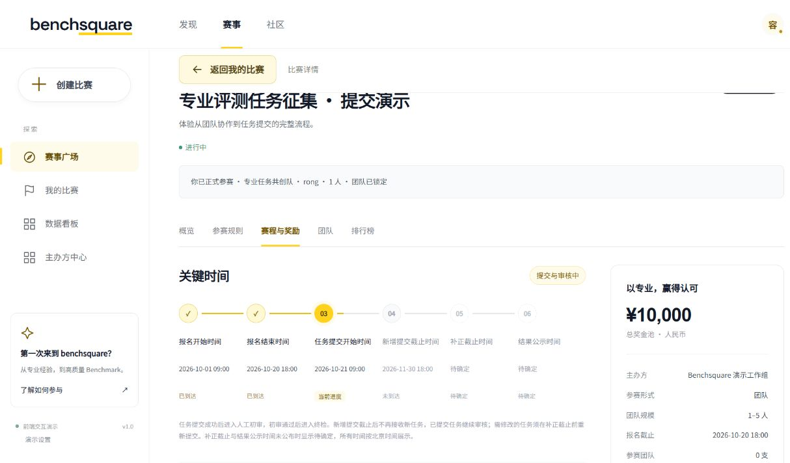

v1.1的P14、P15是待实现后台设计，不再作为本版当前Demo原型；正式任务审核后台归入第五部分待落地能力。

## 4.3 角色与归属

当前按演示身份的稳定ID管理本人任务。同队成员不自动看到彼此的私有材料；队长与成员均可独立准备和提交本人数据，不设置队长批准关卡。

草稿可无比赛、无团队；正式提交必须选择比赛并具备报名和团队资格，记录本人、比赛、团队与版本关联。现有隔离仅为浏览器本地模拟，不构成生产安全权限。

实际审核操作由详情内“演示审核流程”提供，尚无Task审核人员的独立后台及服务端授权。不能因为能进入比赛管理后台，就认为已获得真实Task审核权限。

## 4.4 状态与时间规则

### 看板展示分组与内部阶段

| 看板分组 | 当前归类口径 | 说明 |
| --- | --- | --- |
| 草稿 | 未关联比赛、原始草稿，或存在修改工作副本 | 修改草稿优先于正式状态显示；原提交及历史仍保留。 |
| 待审核 | 已关联且未归入其他三类的记录，包括待初审、终检中 | 终检中可通过反馈说明显示初审已通过；不表示最终录用。 |
| 已审核 | 已审核、需修改、未通过 | 在反馈中区分审核通过待录用、需补正和审核不通过。 |
| 已录用 | 已录用或已通过，且没有优先展示的修改草稿 | 当前仅为示例／模拟结果；不代表官方有效数据统计。 |

模拟处理阶段：草稿正式提交→待初审；初审通过→终检中；初审要求修改→需修改；初审明确不采用→未通过；终检中→已通过／需修改／未通过；原任务重提→新版本待初审。

当前所有状态均能打开修改工作副本。保存修改草稿保留正式内容、原始状态和历史，界面归为草稿；在提交期且资格有效时，当前代码允许从该工作副本重提。此行为与原版终态只读要求不同，按现状记录并列为已知限制，不表述为生产权限已通过。

### 六节点与实际写操作

| 时间节点 | 当前表现 |
| --- | --- |
| 报名开始、报名结束 | 沿用比赛报名与团队资格规则。 |
| 任务提交开始 | 此前可准备草稿，正式提交受赛程检查阻拦。 |
| 新增提交截止 | 当前新入口仍可保存草稿，正式提交被阻拦。 |
| 补正截止 | 未配置显示待确定；当前共用新入口尚未正确放行截止后的原任务补正，见4.10。 |
| 结果公示 | 与补正截止分开显示；时间待定不等于已公示或已录用。 |

所有时间按北京时间展示。保存草稿与正式提交的限制不同，不能用“截止后仅可查看”概括当前整个编辑器。

## 4.5 功能说明

### 4.5.1 入口和抽屉

入口A：侧栏数据看板→新建草稿／继续编辑／查看并修改→共用表单。允许暂不关联比赛。

入口B：我的比赛→查看团队与赛事→比赛详情→提交数据→选本比赛或未关联草稿／新建数据任务→共用表单。未组队记录仍显示完成组队等资格操作。

抽屉在右侧覆盖展示，背景遮罩并禁止操作；包含提交数据和我的提交与草稿。关闭、遮罩和Esc执行离开检查，有未保存修改时允许取消关闭。PC宽度不超过800px。旧工作台链接兼容到比赛详情，不再单独展示旧工作台。

当前抽屉顶部显示来源比赛与个人草稿说明，没有独立团队名称。未提交新草稿可在关联比赛选择中改选赛事；外层标题尚不随之更新。当前比赛内的记录列表实际汇总本人跨比赛记录，选稿列表则按本比赛及未关联草稿过滤。

### 4.5.2 草稿保存与工作副本

草稿不要求必填完整，也不要求双确认；按本人保存，可在无比赛、未组队或提交期外继续整理。选择通用草稿后，仅打开不会关联比赛，保存或提交才写入当前选择。

显式保存、文本恢复缓存及正式提交相互区分。写入失败保留输入并提示。已有正式任务修改时生成工作副本，原正式内容、提交编号、审核意见与版本快照保留；保存后看板显示草稿。当前存在草稿时的分组统计不等同于正式有效状态统计。

### 4.5.3 材料与预览

两类材料为输入材料、参考结果与评测依赖，均选填。不再提供自测证据上传入口。当前入口将实际文件随保存写入当前浏览器的文件存储，刷新后可恢复和下载；尚未发送到服务器。浏览器存储失败时提示保留表单并使用网盘链接。

当前本地实际单文件上限1GB；正式目标规格50GB。上传区仍显示单文件≤50GB，与本地实际限制不一致，需在当前限制中说明。Google Drive／Dropbox链接只检查https及允许域名，不验证远程访问授权或内容可用性。

预览将解题Agent可见的任务描述与输入材料，和审核私有的参考结果、网盘链接、验证标准及确认信息分区。此为前端展示，不代表已实现远程文件鉴权。正文安全渲染，不执行附件。

### 4.5.4 模拟正式提交与版本

两项确认均勾选后按钮启用；点击后检查7项必填业务字段、单选值、短名格式、外链格式、所选文件可用性，以及当前身份、比赛、报名、团队和提交时间。缺项保留输入并定位字段。

本地保存成功后生成模拟编号与版本，状态进入待初审；显示本地模拟成功，不代表真实数据库入库。重提沿用原Task ID，形成新版本和新提交编号，保留历次快照。当前短名查重只覆盖本人同比赛记录，不保证全比赛唯一。

### 4.5.5 模拟初审与终检

详情中待初审或终检中记录提供单独标注的演示审核操作。初审通过才由操作进入终检中；要求修改或未通过必须填原因。终检通过、需修改和未通过均为手工模拟状态更新。记录保留版本、时间、原状态、目标状态及意见；并无真实终检作业、材料交接或结果回传。

合成示例只用于界面展示，可能简化审核历史，不能用于证明真实审核路径或人员授权。本版不采集或审核Model、Harness、Estimated score、Evidence，缺少这些已移除字段不影响保存、校验或提交。

### 4.5.6 反馈、修改与统计

任务详情保留问题意见和历次正式版本，可查看快照。当前修改入口未按终检／终态锁定；新增截止后的合法补正也尚未在共用新入口放行，均按4.10记录。

看板统计按四类展示分组计算本人全部记录，筛选结果单独显示结果数量；包含修改工作副本、未关联草稿和可选合成示例。这些数量不是官方有效Task计数、团队贡献分或排名。

## 4.6 字段

共12项业务字段：单行文本3、多行文本2、单选2、文件上传2、URL 1、确认框2。表单依次为任务信息、材料与参考结果、验证标准、提交确认四个分区；原第05提交确认顺延为第04。正式提交仍要求7项业务必填和双确认，关联比赛不计入业务字段数。

| 序号 | 字段 | 存储映射 | 控件 | 必填 | 格式和规则 | 可见范围 |
| --- | --- | --- | --- | --- | --- | --- |
| 01 | 行业领域 Industry Domain | domain | 单行文本 | 必填 | 自由文本，建议英文；用于归类专业场景。 | 公开 |
| 02 | 软件及版本 Software & Version | software | 单行文本 | 必填 | 软件名加版本号，多个以逗号分隔。 | 公开 |
| 03 | 操作系统 Operating System | os | 单选按钮组 | 必填 | Windows / Linux / MacOS，只能选择一项，MacOS大小写按源文档。 | 公开 |
| 04 | 软件许可 Software Licensing | license | 单选按钮组 | 必填 | 免费或开源 / 商业软件 / 内部或专有软件，对应Free / Open Source、Commercial、In-house / Proprietary；建议开源替代。 | 公开 |
| 05 | 任务说明 Task Description | description | 多行文本 | 必填 | 按目标、起始状态、指令与规则书写；输出物、文件名、格式和约束写在本字段。 | 公开 |
| 06 | 任务短名 Task Short Name | name | 单行文本 | 必填 | 小写字母、数字、下划线，例如video_editing_instance_6；当前只检查本人同比赛内重复；生产比赛批次唯一性待实现。沿用name存储以兼容草稿，不另增普通任务名。 | 公开 |
| 07 | 输入材料 Input Materials | attachments.input | 多文件上传 | 选填 | 任意类型，正式目标单文件≤50GB（当前本地≤1GB）；任务所需起始工程及配套资源放此处，不含参考答案。 | 公开 |
| 08 | 参考结果与评测依赖 Reference Output & Evaluation Dependencies | attachments.reference | 多文件上传 | 选填 | 专家完整执行后的参考成果与评测依赖，建议与预期交付同格式。 | 审核私有 |
| 09 | Google Drive / Dropbox Link | cloudLink | URL | 选填 | https分享链接；大于1GB时建议使用，须开放审核方访问。客户端校验域名和协议，生产阶段另验权限与可用性。 | 审核私有 |
| 10 | 如何验证成功 How should we verify success? | verification | 多行文本 | 必填 | 严格、客观、可机械判定；比什么、怎么比、误差容差、必检项和否决项。支持安全Markdown，不强制100分制。 | 审核私有 |
| 11 | 评测使用确认 | consent | 复选框 | 必须勾选 | I confirm this workflow can be used for Agents’ Last Exam evaluation. 初始不勾选。 | 本人及平台 |
| 12 | 条款与条件确认 | terms | 复选框 | 必须勾选 | I have read and agree to the Terms and Conditions. 初始不勾选；正式上线展示真实条款并记录版本与确认时间。 | 本人及平台 |

### 当前字段与兼容说明

历史兼容：旧记录的model、harness、estimatedScore和evidence附件仅在原存储及版本快照中保留，不再展示、采集或参与校验；旧自测证据缺失或超出当前文件限制，不阻止草稿保存和提交。当前有效附件仅为input与reference。

- 两类附件的当前本地实际限制均为单文件1GB；表中50GB为正式目标，超过1GB当前必须改用网盘链接或缩小文件。
- 任务短名界面要求小写字母、数字和下划线；当前提交以小写形式校验、本人同比赛范围查重，全比赛唯一性尚未实现。
- 不再展示预计完成时间、具体要求、隐藏难点三个独立字段；旧值继续保留，不因本次文档同步删除历史记录。
- 旧project附件归入input；macOS映射为MacOS；旧多选仅恢复第一项。旧记录缺terms时默认不勾选，已有确认值可恢复。
- 正式条款版本、确认时间与操作者的服务端留存尚未接入；Demo确认只用于交互展示。

### 系统记录

保留Task ID、提交编号、版本、创建／更新时间、本人ID、比赛及提交团队关联、正式表单、修改草稿、审核意见及版本快照。当前修改草稿不覆盖正式表单；文件保存在当前浏览器，不是远程受控文件引用。

## 4.7 异常与一致性

| 场景 | 当前处理／边界 |
| --- | --- |
| 本地记录写入失败 | 显示失败，保留页面输入，不表示保存成功。 |
| 附件本地保存失败 | 提示空间或存储不可用，保留表单并建议网盘。 |
| 文件不可恢复 | 标明文件不可用，要求重选或删除后再提交。 |
| 多页面记录变化 | 已有浏览器内冲突提示；不等同于服务端事务或跨浏览器并发。 |
| 演示身份变化 | 保存／提交检查当前身份，记录按稳定ID归本人。 |
| 资格或比赛变化 | 正式提交重新检查报名、团队与赛程；保存草稿不受相同约束。 |
| 外链权限、真实上传、终检故障 | 当前无真实服务，不认定已完成这些异常处理。 |

## 4.8 通知与文案

当前保存、提交和模拟审核通过页面即时提示及详情状态反馈。Task事件未接入头像菜单内的站内通知中心，不能把页面提示算作正式通知投递。

当前采用“草稿已保存”“模拟提交成功”“已模拟更新为某状态”等表达。后续真实服务接入后，才实现按Task和版本准确跳转的提交、初审通过、要求修改、最终结果及期限变更通知。

## 4.9 当前交互验收

| 编号 | 核对场景 | 当前基线 |
| --- | --- | --- |
| AC01 | 看板入口 | 侧栏数据看板可进入；按比赛与按状态切换。 |
| AC02 | 通用草稿 | 未关联比赛、不完整内容及未勾双确认可保存。 |
| AC03 | 比赛选稿 | 提交数据先显示选稿，仅展示本人本比赛及未关联草稿。 |
| AC04 | 关联时点 | 打开通用草稿不立即关联；保存／提交才写入选择。 |
| AC05 | 12项字段 | 四分区、两类附件、操作系统单选及双确认；不存在难度自测输入与入口。 |
| AC15 | 旧自测兼容 | 打开含旧自测字段、无效自评值及不可恢复证据的草稿；不显示这些字段，不因其校验失败，保存/重提保留旧快照。 |
| AC06 | 附件 | 本地保存后刷新可恢复与下载；超过1GB拒绝，50GB为目标提示。 |
| AC07 | 正式提交 | 有比赛、报名、团队、赛程和业务校验；本地成功生成版本及待初审。 |
| AC08 | 模拟审核 | 初审通过进入终检，退回／不通过需原因；均标注本地演示。 |
| AC09 | 修改副本 | 各状态当前均可进入修改；保留原正式记录，保存后看板归草稿。 |
| AC10 | 历史 | 重提保留Task ID，新增版本快照及历史意见。 |
| AC11 | 赛程 | 六节点分别显示，未配置补正／公示显示待确定；截止后可保存草稿。 |
| AC12 | 关闭 | 关闭、遮罩、Esc检查未保存内容；取消后继续编辑。 |
| AC13 | 本人范围 | 看板及共用列表按本人；当前比赛内记录列表也可能包含其他比赛。 |
| AC14 | 实现边界 | 不把浏览器存储、示例审核和四类统计当作生产入库、正式审核与官方有效计数。 |

上述为现状复现口径，不表示4.10限制或第五部分生产能力已经验收通过。

## 4.10 当前限制与后续待落地

| 编号 | 当前事实 | 后续处理 |
| --- | --- | --- |
| L01 | 终检中、已通过、未通过仍可打开修改副本并存在提交期内重提路径 | 正式权限策略另行落地；当前不再写成已实现终态只读。 |
| L02 | 共用新入口未向补正判断传原任务状态，新增截止后阻断合法补正 | 修复原任务与窗口判断后，再更新补正验收。 |
| L03 | 短名查重只取本人同比赛记录 | 全比赛唯一性须服务端约束，草稿占名规则待明确。 |
| L04 | 有修改副本即看板归草稿，原正式状态不在对应分组计数 | 展示分组与官方有效版本统计分离，避免把工作副本统计当成果。 |
| L05 | 比赛抽屉内列表按本人汇总跨比赛记录 | 明确比赛内筛选及比赛标识，避免与选稿列表范围混淆。 |
| L06 | 抽屉标题固定来源比赛，新草稿内可改关联比赛，顶部不显示团队 | 标题与归属同步及团队提示待完善。 |
| L07 | 本地实际1GB上限，上传区提示正式规格50GB | 统一标明本地／正式两种限制。 |
| L08 | Task只有页面即时提示，没有站内通知 | 接入真实Task事件与精确定位后再验收通知。 |

# 五、生产能力与非功能需求

以下为待落地范围，不属于当前Demo已实现事实：

- 服务端持久化任务、真实文件上传及受控存储、附件访问鉴权、外链权限与可用性验证。
- Task人工审核队列、授权人员处理、字段／文件级问题定位、终检交接及结果登记。比赛发布审核后台不替代此能力。
- 正式版本互斥、审核与重提并发、请求幂等、过期结果拒绝及跨浏览器一致性。
- 对合法补正、终态修改、正式状态与工作副本的生产规则落实；当前限制不能作为安全权限实现。
- Task站内通知、失败重试和事件去重；通知失败不能回滚业务结果。
- 按Task及当前有效版本去重的官方有效统计，不能直接复用看板分组数量。
- 正式条款、授权记录、数据保存周期、文件容量与恢复策略；PC键盘操作与错误定位继续保留。

原v1.1后台P14/P15仅为设计参考，当前无对应已实现页面。本版不将其继续列作实截原型。

# 六、埋点

当前未接入真实分析服务，下列为后续观测建议，不能作为已采集数据：

| 事件 | 触发与维度 |
| --- | --- |
| data_dashboard_view | 看板入口、按比赛／状态、筛选维度，不采集正文。 |
| task_submit_panel_open | 来源为比赛详情或看板、来源比赛与当前身份。 |
| task_draft_pick | 选本比赛草稿／通用草稿／新建，Task ID及关联比赛。 |
| task_draft_save | 显式保存结果、是否未关联、是否修改工作副本。 |
| task_submit / task_resubmit | Task与版本、比赛、结果、校验失败类型。 |
| task_review / task_history_view | 模拟处理阶段／历史版本查看；真实审核接入后另记授权事件。 |

不采集任务正文、参考答案、附件内容、网盘凭据和登录信息。不设无依据的量化目标。

# 七、需求依据和版本记录

| 依据 | 用途 |
| --- | --- |
| [在线交互Demo](https://rongyinger.github.io/benchsquare/frontend/) | 2026-10-29重新核对并实截的当前交互基线。 |
| [ALE官方数据提交字段](https://xcnhc87xvcni.feishu.cn/wiki/RYaCwKC6LieE8NkHMRFccCp9npV) | 沿用v1.1已经整理的12项字段；本次未改动其业务字段数量。 |
| 本文v1.1与对应备份 | 保留旧目标要求及后台设计的追溯，不再以旧截图指代当前Demo。 |

v1.2（2026-10-29）：依据用户要求，以当前Demo同步文字、重绘两张流程图、替换P01—P13截图；增加个人数据看板、通用草稿与选稿流程，明确四类展示分组、文件本地保存和当前限制，将生产能力独立列为待落地。
