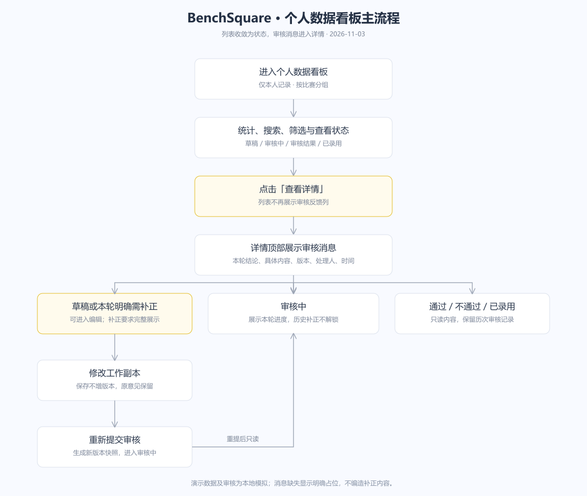
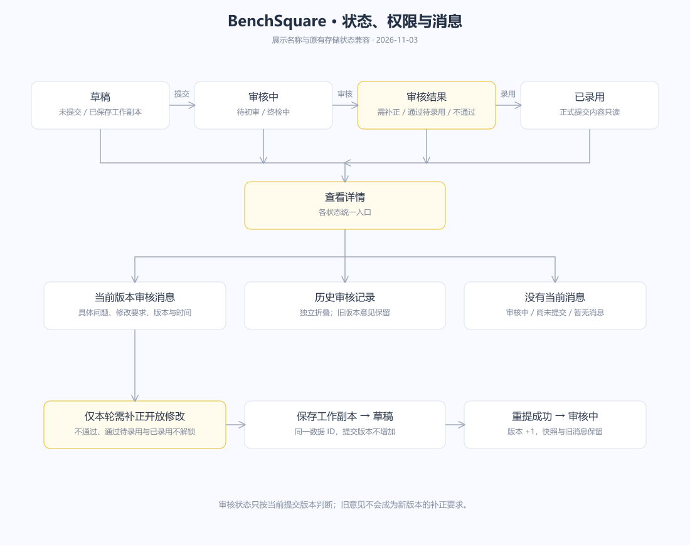
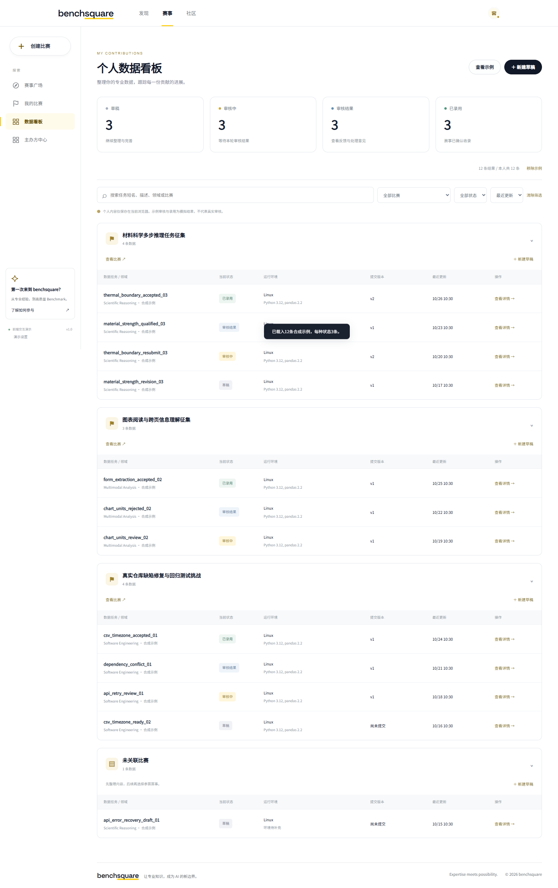
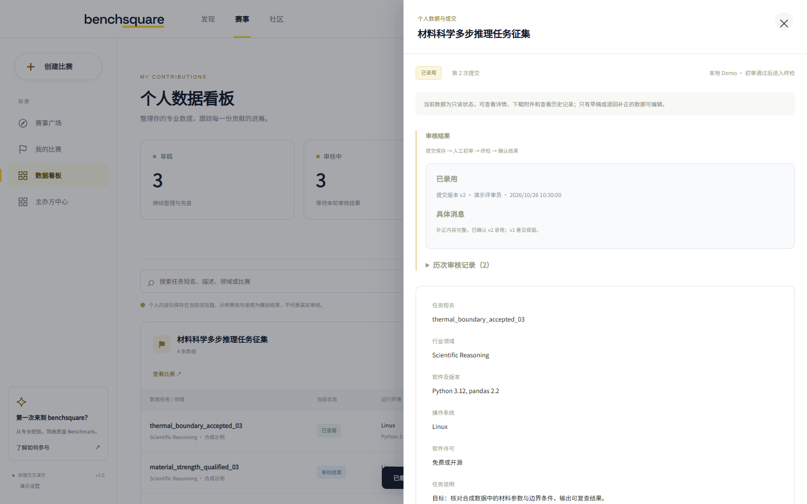
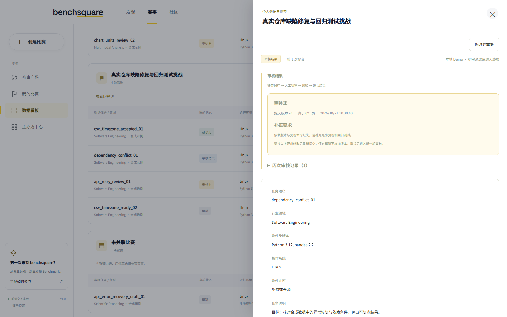

# 个人数据看板：状态与审核消息

版本：v2.1｜更新日期：2026-11-03

对应[飞书个人数据看板 PRD](https://xcnhc87xvcni.feishu.cn/wiki/KuP4wFgtdifEhUkh9fNc6U4Lngg)。本文件记录本次列表与详情调整，其他业务规则沿用在线 PRD。

## 需求与交互

列表删除“最近审核与反馈”整列，保留数据任务/领域、当前状态、运行环境、提交版本、最近更新、操作六列。所有记录统一点击“查看详情”，也可点击任务名称进入详情。

当前状态展示为草稿、审核中、审核结果、已录用；统计卡和状态筛选使用相同名称。“审核结果”兼容原有“已审核”存储值，不迁移或改写历史记录。

详情顶部展示当前提交版本的审核消息，包括结论、具体内容、提交版本，以及已有的处理人和时间。需补正时突出完整问题和修改要求，长文本换行展示，不能在列表用截断摘要替代。没有本轮结果时显示审核正在进行；没有消息时明确显示占位，不编造补正要求。

草稿详情提供“继续编辑”；本轮需补正记录提供“修改并重提”，已有工作副本可继续修改。审核中、通过待录用、审核不通过、已录用保持只读。旧版本补正意见不能解锁新一轮审核中的记录。

历次审核记录独立折叠展示，保留版本、结论、意见、处理人和时间。保存工作副本不增加提交版本，正式重提成功才增加版本并生成快照。

## 流程图

## 原型图

### SCR-01 列表

### SCR-02 只读详情

### SCR-03 补正具体消息

## 验收标准

| 场景 | 预期结果 |
| --- | --- |
| 打开个人数据看板 | 不再展示审核反馈列；六列完整；操作统一为查看详情 |
| 查看统计、筛选和记录状态 | 已审核统一显示为审核结果，筛选数量与原记录一致 |
| 打开本轮需补正记录 | 详情顶部可见具体补正要求、版本、处理人、时间及修改入口 |
| 打开重新提交审核的记录 | 展示本轮审核进度，不把旧版本要求当作当前补正消息，无编辑入口 |
| 打开通过、未通过或已录用记录 | 消息与正式内容只读，附件与历史快照仍可查看 |
| 补正保存或重提 | 保存不增版本，重提增版本，原提交内容与审核历史保留 |

Demo 的记录、审核和录用结果为本地模拟。生产接入要求沿用在线 PRD，不因本次原型调整视为已实现。
