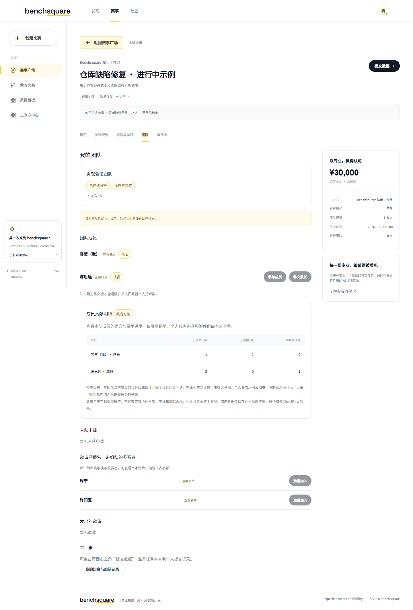
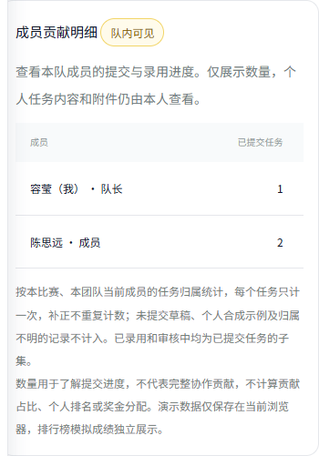

ALE / Benchsquare · 团队贡献明细 · v1.0

负责人：容莹｜更新日期：2026-11-04｜状态：Demo 已实现，待产品评审

# 一、文档说明

本文覆盖比赛详情中公开团队排行榜与队内成员贡献明细的可见范围、统计口径和验收要求。当前版本为单浏览器交互 Demo，数量来自本地任务记录，不代表真实平台统计。

飞书目标：[团队贡献度](https://xcnhc87xvcni.feishu.cn/wiki/EnH8w4MUciGwBWkrogoczIL0nbf)。格式参考页面：https://xcnhc87xvcni.feishu.cn/wiki/KuP4wFgtdifEhUkh9fNc6U4Lngg 。本稿暂沿用仓库中任务提交 PRD 的章节结构；尚未成功读取参考页面或写入飞书，不宣称已完成格式对齐。

## 1.1 名词解释

| 名词 | 当前含义 |
| --- | --- |
| 公开排行榜 | 对所有比赛访问者展示团队整体成绩的榜单，保留现有六列与排名规则。 |
| 成员贡献明细 | 本队成员可见的提交、录用与审核中数量，用于理解个人交付进度。 |
| 已提交任务 | 有正式提交记录的独立任务，按任务 ID 去重，补正与重提不增加数量。 |
| 已录用任务 | 当前内部状态为已通过或已录用的已提交任务。审核通过待录用不计入。 |
| 审核中任务 | 当前处于已提交、待质检、待初审或终检中的任务；需补正与未通过不计入。 |

## 1.2 需求范围

| 本期实现 | 本期不做 |
| --- | --- |
| 团队页按当前成员逐行展示三项任务数量；队长与普通成员一致可见。 | 全场公开个人贡献百分比、个人贡献排行榜。 |
| 排行榜明确展示团队整体成绩；个人明细与公开榜单分开。 | 按提交数量自动分奖、自动打款。 |
| 零数据、读取失败、移动端横向滚动、身份切换。 | 队友私有任务内容、参考结果、附件和云盘链接共享。 |

## 1.3 本次调整

比赛详情「团队」标签在成员列表后展示「成员贡献明细 · 队内可见」。公开排行榜补充范围说明，原有排名、搜索、筛选、折叠和更新行为沿用。个人数据看板继续只展示本人任务。

# 二、需求背景

## 2.1 产品与数据现状

现有榜单按团队展示得分、有效任务和成员名单，个人看板支持本人任务进度，但缺少队内各成员提交进度的汇总。任务记录已经包含比赛、团队和稳定的任务归属标识，可以汇总交付数量。

## 2.2 用户场景与痛点

队长需要确认团队交付进度；普通成员需要核对自己的提交是否进入统计。公开个人贡献占比需要覆盖任务设计、材料生产、复核与协作等信息，当前数据不足以支持。单凭谁提交、提交多少，无法衡量完整贡献，也不适合作为奖金依据。

# 三、一句话目标

让本队成员看清各自的提交与录用进度，同时让公开排行榜聚焦团队成绩。

# 四、功能详细说明

## 4.1 产品流程图

进入比赛详情 → 选择「团队」 → 检查当前身份是否已报名并归属本队 → 展示成员及贡献表 → 按当前比赛和团队读取任务 → 按任务归属汇总 → 展示已提交、已录用、审核中数量。

无团队或已退出登录：不展示贡献表。任务存储损坏：提示无法读取，保留数据。切换身份、比赛或重新进入团队页：重新计算。其他同源窗口更新任务存储：重新渲染。

## 4.2 交互原型图

### P01 桌面团队页

成员列表下方显示贡献表，每位当前成员占一行，姓名旁标注「我」和队长／成员。人数少或单人团队同样展示。表下保留统计口径和贡献边界说明。

### P02 手机团队页

表格保留合理列宽，在自身容器横向滚动；姓名不被挤成逐字换行，页面整体不横向溢出。

## 4.3 角色与归属

| 身份 | 可查看范围 |
| --- | --- |
| 本队队长、普通成员 | 当前比赛本队所有当前成员的三项数量。 |
| 队外参赛者、未组队者、退出登录身份 | 不展示本队贡献表。 |
| 全部访问者 | 可查看公开团队排行榜，不在榜单展开个人明细。 |

任务必须同时匹配 competitionId 与 teamId。归属优先采用 ownerId；历史数据缺失时仅使用首次提交历史的 by。无法确认归属的记录不默认归给队长。离队成员不在当前成员表中，原任务不转移到新队；本表不是团队历史总计。

## 4.4 状态与时间规则

| 记录状态 | 已提交 | 已录用 | 审核中 |
| --- | --- | --- | --- |
| 首次提交前草稿 | 不计 | 不计 | 不计 |
| 已提交／待质检／待初审／终检中 | 计一次 | 不计 | 计一次 |
| 需修改／未通过／已审核 | 计一次 | 不计 | 不计 |
| 已通过／已录用 | 计一次 | 计一次 | 不计 |
| 已有正式版本的修改工作副本 | 保留原任务一次计数 | 按原提交当前状态 | 按原提交当前状态 |

无需等待比赛结束即可查看进度。截止时间仍由现有提交流程控制；本表不新增提交权限。已录用和审核中是已提交的子集，不能将三列直接相加。

## 4.5 功能说明

| 编号 | 需求与行为 |
| --- | --- |
| FR-01 | 团队页在当前成员列表后提供四列表格：成员、已提交任务、已录用任务、审核中任务。 |
| FR-02 | 只在当前身份已报名、属于当前团队且未退出演示登录时展示。 |
| FR-03 | 按比赛、团队、当前成员归属过滤，同一任务 ID 去重，不按提交版本累计。 |
| FR-04 | 排除个人合成示例、未提交草稿、其他比赛和团队、归属不明任务。 |
| FR-05 | 没有记录的成员显示 0；全队均为 0 时解释首次提交后更新，不展示虚构贡献。 |
| FR-06 | 展示姓名、我和角色标签，只投影汇总数量，不渲染任务短名、说明、参考结果、附件或链接。 |
| FR-07 | 公开榜单保持团队维度，说明个人进度在本队团队页查看；不生成个人贡献占比或个人排名。 |
| FR-08 | 存储损坏时显示读取失败提示，不将错误解释为零贡献，不覆盖原数据。 |
| FR-09 | 切换身份、比赛和重新进入页面时重算；窄屏表格独立滚动。 |

## 4.6 字段

| 字段 | 来源与展示 |
| --- | --- |
| 成员 | 当前团队成员 ID 映射当前资料姓名，按成员原顺序展示，不按数量排序。 |
| 已提交任务 | 有正式版本、提交历史或已提交阶段的独立任务数。 |
| 已录用任务 | 当前状态为已通过／已录用的任务数。 |
| 审核中任务 | 当前状态为已提交／待质检／待初审／终检中的任务数。 |

## 4.7 异常与一致性

数据读取失败时提示「暂时无法读取任务记录，请保留本地数据后重试」。归属不明的历史数据排除并在口径说明中告知，不采用猜测归属。Demo 个人示例使用 mock 标记，与本队进度隔离。公开排行榜使用预置模拟成绩，不能与当前任务汇总直接对账。

## 4.8 通知与文案

本期不新增通知。空态：「本队暂无已提交任务，成员首次提交后会更新对应数量。」范围说明：「数量用于了解提交进度，不代表完整协作贡献，不计算贡献占比、个人排名或奖金分配。」

## 4.9 当前交互验收

| 编号 | 场景 | 预期 |
| --- | --- | --- |
| AC-01 | 队长与普通成员分别查看 | 都能看到本队当前成员汇总；队外身份看不到。 |
| AC-02 | 同任务首次提交、补正、再次提交 | 已提交仍为 1，当前审核阶段随状态变化。 |
| AC-03 | 混入草稿、个人示例、其他比赛／团队任务 | 不计入当前表；归属不明不转给队长。 |
| AC-04 | 当前成员零记录、全队零记录 | 显示 0；全队零数据有说明。 |
| AC-05 | 检查表格 DOM 和排行榜 | 无私有任务内容；排行榜仍为原有六列。 |
| AC-06 | 390px 窄屏 | 表格自身滚动，姓名可读，页面无整体横向溢出。 |
| AC-07 | 损坏任务存储 | 明确读取失败，不覆盖数据。 |

自动检查：`node frontend/team-contributions-model.test.cjs`；浏览器检查：启动本地服务后运行 `node frontend/team-contributions-browser.test.cjs`，可用 BENCHSQUARE_PLAYWRIGHT 指向现有 Playwright。

## 4.10 当前限制与后续待落地

Demo 的「队内可见」是页面展示规则，数据仍在同一浏览器 localStorage 中；不同设备不会同步，不能替代生产鉴权。后续接入后端时，应由服务器验证当前团队关系并只返回成员汇总字段；私有材料仍按原权限返回。

# 五、生产能力与非功能需求

生产版本应基于稳定用户 ID、任务 ID、提交版本和明确的录用事件计算汇总，并在任务状态变更后保持口径一致。需要服务端鉴权、跨设备同步及错误恢复；当前 Demo 未实现这些能力。姓名以转义文本展示。当前版本不设缺少依据的性能或贡献提升指标。

# 六、埋点

当前 Demo 不发送埋点。生产评估可记录贡献表曝光、读取成功／失败和用户角色，不记录任务内容、附件或贡献价值判断。事件定义与保留周期待接入分析平台时评审。

# 七、需求依据和版本记录

| 日期 | 版本 | 调整 |
| --- | --- | --- |
| 2026-11-04 | v1.0 | 根据已确认方案：公开团队成绩、队内成员数量明细，不计算个人贡献占比或自动分奖。 |

关联文档：[榜单公示 PRD](../leaderboard/README.md)、[Task 提交与审核 PRD](../submission/README.md)。
